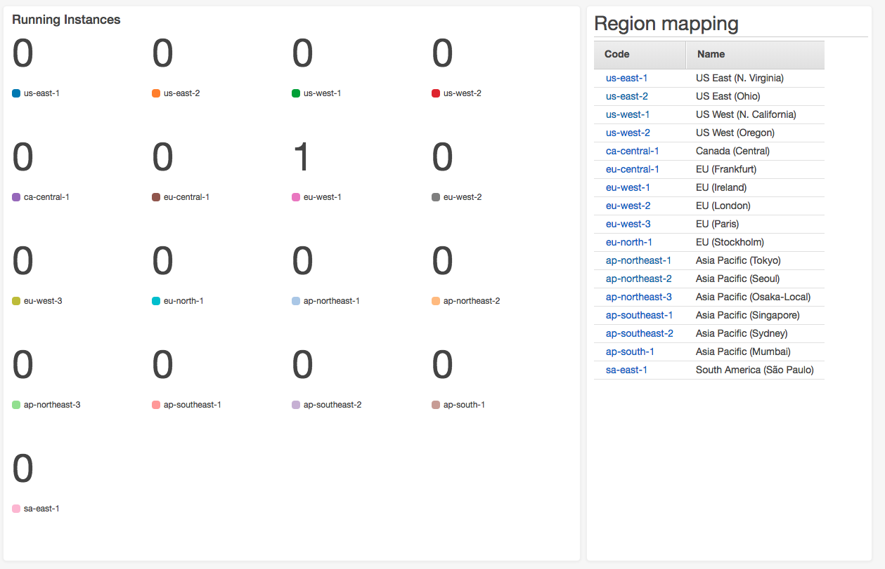
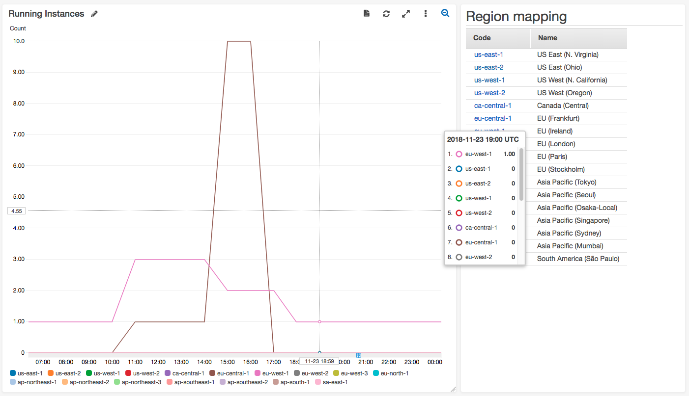

# Amazon EC2 Global Dashboard

Monitor how many EC2 instances are running across all enabled regions with a single CloudWatch dashboard.

### Details

The dashboard is created by a CloudFormation template. A Lambda function runs every 15 minutes and:

1. lists the regions enabled in your account,
2. counts running EC2 instances in each region (optionally only those with a given tag),
3. publishes the counts to CloudWatch as the custom metric `Running-instances` / `running-state` (dimension `region`),
4. rebuilds the dashboard so it always matches your current regions.

The dashboard is also built when the stack is created or updated, and removed when the stack is deleted. The stack can be created in any region; the metrics and dashboard live in that region.

Resources created by CloudFormation:
- AWS::Logs::LogGroup
- AWS::IAM::Role
- AWS::Lambda::Function
- AWS::Lambda::Permission
- AWS::Events::Rule
- Custom::DashboardSync (builds and removes the `Amazon_EC2_Global_Dashboard` dashboard)

### Setup

1. Save `amazon-ec2-global-dashboard.yaml` locally.
2. In the CloudFormation console choose **Create stack** -> **With new resources** -> **Upload a template file**.
3. Upload the file -> **Next**.
4. Name the stack (for example `amazon-ec2-global-dashboard`) and choose the parameters below -> **Next**.
5. No changes are needed on *Configure stack options* -> **Next**.
6. On *Review*, acknowledge that CloudFormation can create an IAM role -> **Create stack**.

The dashboard appears when the stack finishes creating. The stack's `DashboardUrl` output links to it.

Or from the CLI:

```
aws cloudformation deploy --template-file amazon-ec2-global-dashboard.yaml \
  --stack-name amazon-ec2-global-dashboard --capabilities CAPABILITY_IAM
```

### Parameters

| Parameter | Default | Description |
|---|---|---|
| `MonitorMode` | `all` | `all` counts every running instance. `tag` counts only running instances with the tag below. |
| `TagKey` | `amazon-ec2-global-dashboard` | Tag key used in `tag` mode. Enter the plain key, without a `tag:` prefix. |
| `TagValue` | `enabled` | Tag value used in `tag` mode. |

> **Upgrading from the earlier version:** `TagBasedParameter`, `TagKeyParameter` and `TagValueParameter` were renamed to `MonitorMode`, `TagKey` and `TagValue`, and the key no longer takes a `tag:` prefix.

### Widgets

- **Running Instances** - the current number of running instances per region, with a sparkline.
- **Region mapping** - region codes and names, linked to the running instances in each region's console.
- **Running Instances (history)** - a line graph of the same metrics over time.




### Notes

- Regions that are not enabled in your account (opt-in regions) are not included. They appear once you enable them.
- If counting fails in a region, that region keeps its last value and the error is logged to the `/aws/lambda/amazon-ec2-global-dashboard` log group (kept for 30 days).
- Custom metrics and dashboards are billed by CloudWatch, one metric per region. See [CloudWatch pricing](https://aws.amazon.com/cloudwatch/pricing/).
- The template uses fixed resource names (function, log group, dashboard), so it can be deployed only once per region and account.
- Written for the standard `aws` partition. GovCloud and China regions are not tested.

## Security

See [CONTRIBUTING](CONTRIBUTING.md#security-issue-notifications) for more information.

## License Summary

This sample code is made available under the MIT-0 license. See the LICENSE file.
